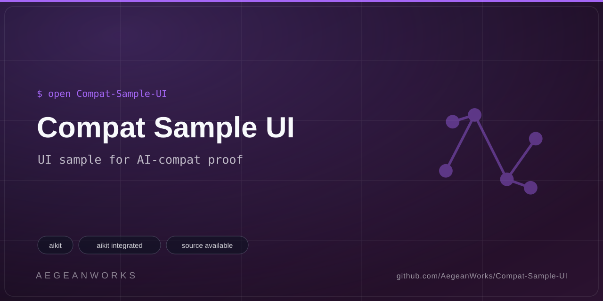

# Compat Sample UI

<!-- aegean:media:start -->
<p align="center"></p>
<p align="center"><a href="LICENSE"></a> <a href="https://github.com/AegeanWorks/AIKit"></a></p>
<!-- aegean:media:end -->

> **Archived**: Retired experiment (archived 2026-11-05). This project is read-only; its GitHub repository is archived.


Built for AIKit (ADR-315): mock UI sample for the AI-compat drive proof, with
no runnable interface.

> **What this is.** A mock: `inventory.py` prints three placeholder
> `kind|name|locator` lines and `demo.py` prints seeded `WORLD-DELTA` lines.
> It exists only to prove the compat contract shape for UI-kind projects.

## ⚡ 30-Second Cold-Start Quick Reference

- **Runtime Prerequisites**: Python 3.10+ (stdlib only, no extra dependencies)
- **Canonical Regression Shield Gate**:
  ```bash
  python -m unittest discover
  ```

### 🛠️ AIKit Commands (run from the AIKit folder)
| Role | Command |
|---|---|
| Status, task and gates | `python aikit.py status compat-sample-ui` |
| Phase 4: every gate | `python aikit.py check compat-sample-ui` |
| Repair memory and map, then check | `python aikit.py fix compat-sample-ui` |
| Resume an interrupted task | `python aikit.py resume compat-sample-ui` |

## 📦 What's Inside

```text
compat-sample-ui/
├── .gitignore                <- transient AIKit state excluded
├── LICENSE                   <- Aegean License 1.1 (AL-1.1): free personal use
├── COMMERCIAL.md             <- Commercial licensing terms
├── LICENSES/                 <- REUSE license texts
├── REUSE.toml                <- Machine-readable SPDX metadata
├── README.md
├── demo.py                   <- scripted WORLD-DELTA drive (compat)
├── inventory.py              <- UI inventory kind|name|locator (compat)
├── assets/                   <- logo, social preview, screenshots
├── tests/                    <- regression shield (unittest)
└── .aikit/                   <- this project's memory: record, ledger, decisions
```

<!-- aegean:brand-assets:start -->
## 🎨 Brand Assets

> **AI-Generated Brand Artwork.** The banner and logo are **AI-generated brand assets**. They are illustrative and may not literally depict every feature or the full project scope.
<!-- aegean:brand-assets:end -->

## 📜 License

Free for personal use under the Aegean License 1.1 (AL-1.1); see [LICENSE](LICENSE). Any commercial use needs the Aegean Commercial License 1.0 (ACL-1.0); see [COMMERCIAL.md](COMMERCIAL.md).
